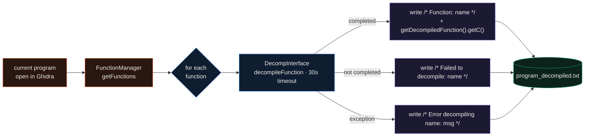

<div align="center">

# Ghidra Decompile All

**A Ghidra script that decompiles every function in the open program and writes them all to one C-style text file.**


</div>

Ghidra decompiles one function at a time in the UI. When I want the whole binary as text, to grep across it, diff two builds, or paste it into notes during a CTF, clicking through functions is slow. This script walks every function through Ghidra's decompiler API once and dumps the C for all of them into a single `<program>_decompiled.txt`, so the full program is in one file I can search.

## How it works



The whole script is 31 lines. It opens a `DecompInterface` on `currentProgram`, asks the `FunctionManager` for every function (including external and thunk functions, since `getFunctions(True)` walks them in address order), and decompiles each one with a 30-second timeout and a `ConsoleTaskMonitor`. Each result is written straight to the output file, and the output directory is chosen with Ghidra's `askDirectory` prompt when the script runs.

## Output

Every function becomes one block. A successful decompile is labelled with the function name and followed by Ghidra's own C output; a function the decompiler could not finish, or that raised, is written as a comment so nothing is silently dropped:

```c
/* Function: main */
undefined8 main(void)
{
  ...               // exactly what DecompiledFunction.getC() returns
}

/* Function: validate_input */
bool validate_input(char *input)
{
  ...
}

/* Failed to decompile: _init */

/* Error decompiling tricky_func: timed out */
```

The C bodies are produced by Ghidra, so their quality depends on the analysis (types, signatures and names are whatever the program's analysis recovered). The three comment forms above map one to one to the three branches in the loop: completed, not completed, and exception.

## Quickstart

Run it from the Script Manager against a program you have already imported and analysed:

1. Open your binary in Ghidra and let auto-analysis finish.
2. `Window -> Script Manager`.
3. Either click the "Create New Script" button, choose Python, and paste in `ghidra-decompile-all.Jython`; or save that file with a `.py` name into one of the directories listed under "Manage Script Directories" and refresh the list.
4. Select the script and click Run.
5. Pick an output folder in the directory chooser.
6. The console prints the path, and `<program>_decompiled.txt` is written to that folder.

Headless is possible but needs one change, because the script asks for the output folder through the GUI. `askDirectory` has no equivalent under `analyzeHeadless`, so replace that line with a fixed path (or read `getScriptArgs()[0]`), then:

```bash
analyzeHeadless /path/to/project ProjectName \
  -import ./target.bin \
  -postScript ghidra-decompile-all.py
```

Save the script with a `.py` extension for either workflow; Ghidra identifies Python (Jython) scripts by extension, not by the `.Jython` name used in this repo.

## Repository map

```text
ghidra-decompile-all.Jython   the script: iterate functions, decompile, write one .txt
LICENSE                       MIT
```

## Limitations

- It runs inside Ghidra on Jython 2.7 and uses the script globals (`currentProgram`, `askDirectory`), so it is not a standalone program and will not run under CPython.
- As written it prompts for the output directory, so headless runs need the one-line edit above.
- There is no filtering: every function in `getFunctions(True)` is attempted, including library thunks and externals, which can make the file large on a statically linked binary.
- Output quality is whatever Ghidra's decompiler and the current analysis produce; the script does not re-type, rename, or clean the C.

## License

MIT. See [LICENSE](LICENSE).
